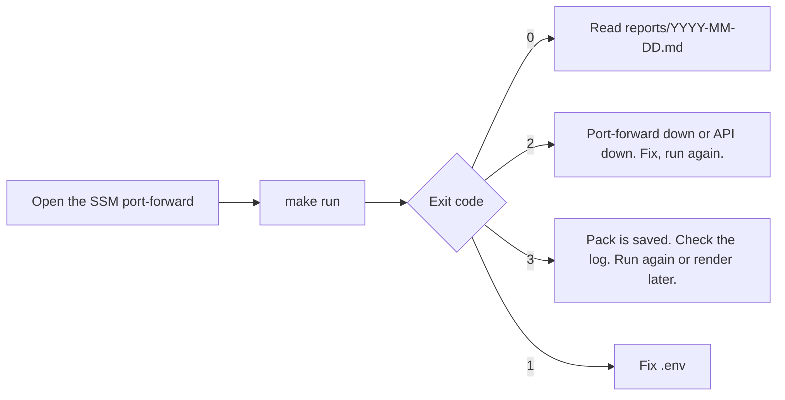

# Runbook — Blockford Daily Review

**Version:** 0.1 (2026-10-07)
**Status:** draft. Commands confirmed in pass 0a on 2026-10-07: every `make` target runs. From pass 1b (2026-10-08) `pull-only` runs the health check, pulls the 23 endpoints and saves the data pack; `derived.json` comes in pass 2a; `run` and `render` parse and exit 0 without doing anything until their passes land. Port and base path are final (question 2 ruled 2026-10-07). CI added in pass 0b on 2026-10-07 (section 10).

## 1. Before the first run

| Need | Where from |
|---|---|
| Python 3.11 or later and `uv` | `uv` is installed on this machine (0.12.x). `uv sync` built `.venv` on Python 3.11.8 from pyenv; Python 3.12.3 is also present. |
| An Anthropic API key | Put in `.env`. Never committed. |
| The SSM port-forward to the Blockford app | App RUNBOOK section 2b. Local port 3300. See section 1.1 below. |
| `vendor/API-SPEC.md` | In place. Copied 2026-10-07, spec version 1.0, header line says so. |

Setup:

```bash
cp .env.example .env     # fill in ANTHROPIC_API_KEY (needed by run only); BLOCKFORD_API_BASE_URL is pre-filled
make setup               # uv sync
make check               # uv run ruff check src tests, then uv run pytest
```

### 1.1 The tunnel

From the app repo, `/mnt/c/Users/rjd61/Documents/RebelWealth/scouts/corridor-scouts` on this machine (confirmed by Jason, 2026-10-08), open the tunnel and leave that shell running:

```bash
export AWS_PROFILE=blockford-admin
cd /mnt/c/Users/rjd61/Documents/RebelWealth/scouts/corridor-scouts/infra
INSTANCE_ID=$(terraform output -raw instance_id)
aws ssm start-session --target "$INSTANCE_ID" \
  --document-name AWS-StartPortForwardingSession \
  --parameters '{"portNumber":["3000"],"localPortNumber":["3300"]}'
```

Then confirm that prod is what is answering:

```bash
curl -s http://localhost:3300/corridor-scout/api/health | head -c 200
```

Facts about the tunnel that shape the code:

- The local port is **3300**, not 3000. If the local dev stack is running on 3000, a wrong port would quietly read the laptop's data instead of prod.
- Keep the `/corridor-scout` prefix. The app's base path moved `/api/*` too, so a bare `/api/...` returns 404.
- The tunnel closes after a period of inactivity. Calls then get **connection refused**, not an HTTP error. The script reports that as "tunnel down", in the health check, in failure records, and in `api_get` results, so the agent never reads it as "no data".
- Only localhost on the machine running the tunnel can use it. That is why the script, not Claude, makes every call.
- It is the prod database with no edge in front. The only write routes need `ADMIN_SECRET` today, but the tools stay GET-only regardless.

## 2. Settings

All read by `config.py` from the environment, with `.env` loaded first.

| Setting | Meaning | Default |
|---|---|---|
| `ANTHROPIC_API_KEY` | Claude API key. | none. Required by `run` only; `pull-only` and `render` run without it (Q14). |
| `BLOCKFORD_API_BASE_URL` | The port-forward address plus `/corridor-scout/api`. | `http://localhost:3300/corridor-scout/api` |
| `MODEL` | The agent's model. | `claude-sonnet-5-5` |
| `MAX_TOOL_CALLS` | `api_get` calls allowed per run. | `15` |
| `MAX_OUTPUT_TOKENS` | `max_tokens` per Messages API response. | `16000` |
| `HISTORY_DAYS` | Days of history pulled and past reports fed in. | `7` |

A malformed setting, or a missing key on `run`, stops the command before any API call and names the setting. Exit 1. One message names every bad setting at once and never prints a value.

How values are read (T-25):

- The real environment wins over `.env`.
- A blank value counts as not set. A blank `ANTHROPIC_API_KEY` is missing; a blank optional setting takes its default.
- `MAX_TOOL_CALLS`, `MAX_OUTPUT_TOKENS` and `HISTORY_DAYS` are whole numbers of 1 or more.
- `BLOCKFORD_API_BASE_URL` starts with `http://` or `https://`, has a host, and, if it names a port, a port from 1 to 65535. Anything else is a bad setting (exit 1), not an unreachable API.

## 3. Daily routine



1. Open the port-forward (app RUNBOOK section 2b).
2. Run:

   ```bash
   make run                 # uv run daily-review run
   ```

3. Read `reports/YYYY-MM-DD.md`. The JSON beside it is the source.

Other commands, with the `uv` command each target runs:

```bash
make pull                     # uv run daily-review pull-only: save the data pack and derived.json, no agent
make render DATE=YYYY-MM-DD   # uv run daily-review render reports/YYYY-MM-DD.json; without DATE it prints the usage and fails
make help                     # list every target
uv run daily-review run --date YYYY-MM-DD   # reuse that date's saved pack; no pull. No make target; it is the exception, not the routine.
```

## 4. What a run writes

| Path | Content |
|---|---|
| `data/YYYY-MM-DD/raw/<name>.json` | Each response, verbatim |
| `data/YYYY-MM-DD/failures/<name>.json` | One per failed call |
| `data/YYYY-MM-DD/manifest.json` | One row per call with flags |
| `data/YYYY-MM-DD/derived.json` | The computed stats |
| `reports/YYYY-MM-DD.json` | The report, agent sections plus `run` |
| `reports/YYYY-MM-DD.md` | The rendered report |
| `state/watchlist.json` | The updated watch list |

`pull-only` writes `derived.json` from pass 2a. Its window fields and data quality section are computed, and from pass 2b the finding comparison and corridor tier changes; each other statistic says `Not computed yet: pass 2c.` (or 2d, 2e) in its `missing` until its pass lands (T-35). The comparison base is the previous `derived.json`'s `findings.open` and `corridorTierChanges.tiers`; a surface that could not be read keeps its earlier findings there, so it reports nothing as gone (T-40, T-41).

Running twice on one date replaces that date's files: a second pull first removes the date's `raw/`, `failures/` and `manifest.json` (T-30), so the pack is always one pull, and `derived.json` is written again. The previous-run comparison uses the newest earlier date with a usable `derived.json`, never the same date (T-37). `previousRunDate` in `derived.json` names it.

## 5. Exit codes

| Code | Meaning | What to do |
|---|---|---|
| 0 | Report written (`pull-only`: pack saved). Endpoint failures, if any, are in the data quality section, and in `failures/` and the manifest. | Read the report. |
| 1 | Bad or missing setting, or a usage error: unknown command, missing argument, or a `--date` that is not a real `YYYY-MM-DD` date (T-23). | Fix `.env`, or the command line. The message names the problem. |
| 2 | `/health` unreachable, or it answered with something that is not the API: nothing written. Or (`pull-only`) a call during the pull was "tunnel down": the pack is saved with its failure records, and `derived.json` lists them (T-31, T-38). | Read the message: "tunnel down" means reopen the port-forward (section 1.1); an HTTP status, a timeout or "not a JSON object" means check the app and the port. Run again. |
| 3 | Claude call failed, refused, hit `max_tokens`, or the JSON did not validate. Data pack kept. | Read the log. Run again. The pack for the date is already saved, so `run --date YYYY-MM-DD` reuses it without pulling again. |

## 6. Troubleshooting

| Symptom | Likely cause | Check |
|---|---|---|
| Exit 2 at once, `health check failed: tunnel down: connection refused at localhost:3300` | Tunnel not open or closed from inactivity, or wrong port in `BLOCKFORD_API_BASE_URL` | Reopen the tunnel (section 1.1); `curl` the health path by hand |
| Exit 2, `health check failed: HTTP <status>: ...` | The app answered with an error, or a 3xx (redirects are not followed, T-26) | The status and the start of the body are in the message; `curl` the health path by hand |
| Exit 2, `health check failed: timeout: no answer from /health within 30 s` | The app is slow or hung behind an open tunnel | Check the app; run again |
| Exit 2, `health check failed: unreachable: ...` | Not the tunnel: for example a host name in `BLOCKFORD_API_BASE_URL` that does not resolve | The base URL in `.env` |
| Exit 2, `health check failed: unreachable: the body from /health could not be decoded: ...` | The answer's `Content-Encoding` does not match its bytes: something between the script and the app mangled it | `curl -sv` the health path by hand and read the headers |
| Exit 1, `Bad settings. ... BLOCKFORD_API_BASE_URL: ...` | The base URL has no host, or a port that is not a number from 1 to 65535 | The base URL in `.env` |
| Exit 2, `health check failed: health body is not a JSON object` | Something other than the API answered on that port | The port in `BLOCKFORD_API_BASE_URL`: 3300 is the tunnel, 3000 is the local dev stack |
| `health:` line shows `missing` or `null` for a field | `/health` answered without that field, or with null. The run goes on (T-27). | Compare with the `GET /api/health` section of `vendor/API-SPEC.md`; tell Jason if the API changed |
| Exit 2 after `tunnel down during the pull; the pack is saved with its failure records.` | The tunnel closed during the pull, after `/health` answered | Reopen it (section 1.1) and run again; the new pull replaces the saved one (T-30) |
| `api_get` results saying "tunnel down" mid-run | The tunnel closed during the agent's turn | Reopen it and run again |
| `pull: <name> failed: timeout: no answer from ... within 30 s` | That endpoint is slow. On 2026-10-08 the liquidity reads took 5 to 15 s each and the whole pull about 95 s | Run again; if the same endpoint times out every day, tell Jason (the timeout is `DEFAULT_TIMEOUT` in `client.py`, T-26) |
| Manifest row with `rowsAtLimit` or `totalExceedsRows` set | The page was cut at its limit: not an error, a data quality item (R-PULL-4, R-PULL-8) | Expected today on `anomalies_*`, `exceedances`, `spread_history`, `bsh`, `issuer_flows` (question 27) |
| `previous derived.json skipped: not a JSON object with runDate <date>: <path>` | That date's `derived.json` is damaged, or was edited or copied by hand | The run compared with the next older date instead (`previousRunDate`). Delete the file, or fix its permissions if the message came from a folder that cannot be read; no command rebuilds an earlier date's `derived.json` (T-37) |
| `derived.json` `dataQuality.failedCalls` row with status 200 and `the body is not a JSON object` | That endpoint answered 2xx with something other than a JSON object: an error page from a proxy, or a body cut short (T-39) | The raw file under `raw/<name>.json`, saved as received; `curl` the path by hand |
| `derived.json` `findings.note` or `corridorTierChanges.note` says `The previous run (<date>) holds no findings to compare with.` (or `no corridor tiers`) | That date's `derived.json` was written before pass 2b, or its `open` or `tiers` is damaged (T-40) | Nothing: this run fills `open` and `tiers`, and the next run compares as usual |
| `derived.json` `findings.surfacesMissing` lists a surface | Its call failed (see `dataQuality.failedCalls`), or its body did not give every finding with an id (T-41). Its earlier findings are carried in `findings.open`, never reported gone | If the call failed, as for that failure. If it answered 200, read `raw/<name>.json` against its section in `vendor/API-SPEC.md`: the shape may have changed |
| `flow_history` failure record with 400 | `hours` or `limit` not an integer in range (`hours` 1 to 720, `limit` 1 to 5000) | The catalogue value in `pull.py`; the 400 body states the range |
| Many failure records with the same HTTP status | App restarted mid-run | Run again |
| Exit 3 with a schema error | The model's JSON did not validate, or `max_tokens` was hit | The log shows the stop reason and the validation message. If `max_tokens`, raise `MAX_OUTPUT_TOKENS`. |
| Exit 3 with `refusal` | The model declined | Read the `stop_details` category in the log. Tell Jason. No automatic fallback in v1 (T-08). |
| `toolCapReached` true in the report | The agent used all `MAX_TOOL_CALLS` | Read what it was looking for. Raising the cap is Jason's ruling. |
| `cacheRead` is zero in `run.tokenUsage` | Something volatile crept into the system prompt or tools | The agent test for byte-stable system blocks; diff two requests' rendered prompts |
| Delete warning at the end of the run | Files API delete failed | The log lists the file ids. Delete them by hand (section 7). |
| 401 from the Claude API | Bad key | `.env` |
| `warning: VIRTUAL_ENV=... does not match the project environment path .venv` on every `uv` command | A pyenv or other virtualenv is active in the shell. `uv` ignores it and uses the project's `.venv`. | Harmless. To silence it, `unset VIRTUAL_ENV` in that shell. |

## 7. Leftover uploaded files

Uploads are deleted at the end of every run. If a run died before that, list and delete by hand:

```bash
uv run python -c "import anthropic; c=anthropic.Anthropic(); [print(f.id, f.filename) for f in c.files.list()]"
uv run python -c "import anthropic, sys; anthropic.Anthropic().files.delete(sys.argv[1])" file_xxx
```

## 8. Cost

Measured in build step 3 and recorded in [AGENT-DESIGN.md](AGENT-DESIGN.md) section 7. The `run.tokenUsage` section of every report shows input, output, cache read, and cache write tokens for that run. The code execution sandbox has a monthly free allowance; one run a day stays inside it.

## 9. Logs

The run logs to stderr with the standard `logging` module, one line per event, each starting with a UTC timestamp and the level (T-28). The health line comes first, so the log shows which deployment answered:

```
2026-10-08T06:00:01Z INFO health: status=operational corridorsMonitored=47 updatedAt=2026-10-08T05:59:30Z
```

The `httpx` library's own request lines are held back (its logger is set to WARNING), since they print the full URL. A bad-settings message is one line that names every bad setting.

After the health line, the pull logs where the pack was saved (with `derived.json` in it, T-38), then one WARNING per failed call (its name and the first 300 characters of its error, on one line; the whole error is in its failure record), then a summary. If any call was "tunnel down", two ERROR lines follow: `tunnel down during the pull; ...` and the tunnel hint.

```
2026-10-08T05:22:05Z INFO pack saved: /home/jdorman/projects/custom_agents/liquidity_read_agent/data/2026-10-08
2026-10-08T05:22:05Z WARNING pull: bsh failed: timeout: no answer from /bsh within 30 s
2026-10-08T05:22:05Z INFO pull: 23 calls, 22 ok, 1 failed (timeout 1)
```

If an earlier date's `derived.json` cannot be used as the previous run, one WARNING names it before the `pack saved` line (T-37):

```
2026-10-08T05:22:05Z WARNING previous derived.json skipped: not a JSON object with runDate 2026-10-07: /home/jdorman/projects/custom_agents/liquidity_read_agent/data/2026-10-07/derived.json
```

Each call's status and bytes are in `manifest.json`, not the log. Later steps add: each Messages API request with stop reason and usage; each tool call with path, query, status, bytes, cut or not; each upload and delete. No log line contains the API key or a request body.

## 10. CI

GitHub Actions runs `.github/workflows/check.yml` on every push and every pull request, on any branch. It is the same gate as on Jason's machine, so a change that passes `make check` locally passes here too.

What runs, in order, on `ubuntu-latest` with Python 3.11 (the floor, Q15):

1. Check out the commit, with no saved credentials.
2. Install `uv` (`astral-sh/setup-uv@v7`), with its cache on.
3. `uv sync --locked`. Fails if `uv.lock` is out of step with `pyproject.toml`.
4. `make check`: ruff, then pytest.

The workflow has `contents: read` only and is given no secrets. No step can reach the Claude API with a key or the Blockford API, which only localhost can reach. The test suite cuts off the network as well (TESTING section 1).

Reading a red check:

| Red step | Cause | Fix |
|---|---|---|
| `uv sync --locked` | `pyproject.toml` changed without `uv.lock` | `uv lock` locally (or `uv add`, which writes both), then commit `uv.lock` |
| `Lint, then test`, ruff output | A lint error, or a function over complexity 10 | `make lint` locally; split the function rather than raising the limit |
| `Lint, then test`, a test fails | A behaviour broke | `make test` locally; the test name says the requirement |
| A test fails with `tests never touch the network (T-21)` | A test reached a socket instead of a fake | Give the test the fake for that I/O module (TESTING section 3) |
| `test_this_checkout_tracks_nothing_it_should_not` | A file under `data/`, `reports/` or `state/`, an `.env` file, or an image in `docs/` was committed | `git rm --cached <path>`, and commit. If it was `.env`, rotate the key: it is in the history. |

Branch protection on `main`, so the check must pass before a merge, is set by Jason in the GitHub repository settings (Settings, Branches). It is not held in the repo. It is not set yet: Jason waived it for pass 0b on 2026-10-08, and pass 0b task 6 keeps it open. Until it is set, a red check does not stop a merge; read the check before merging.
